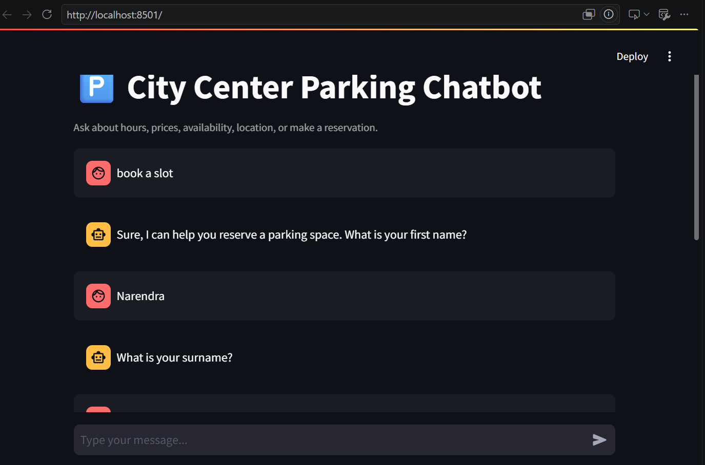
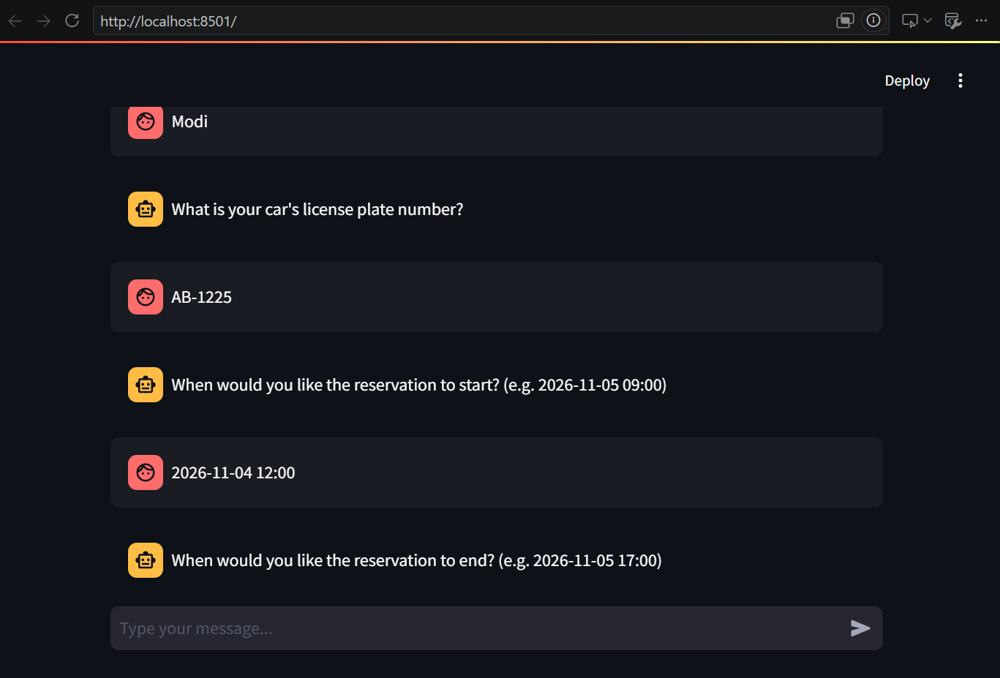
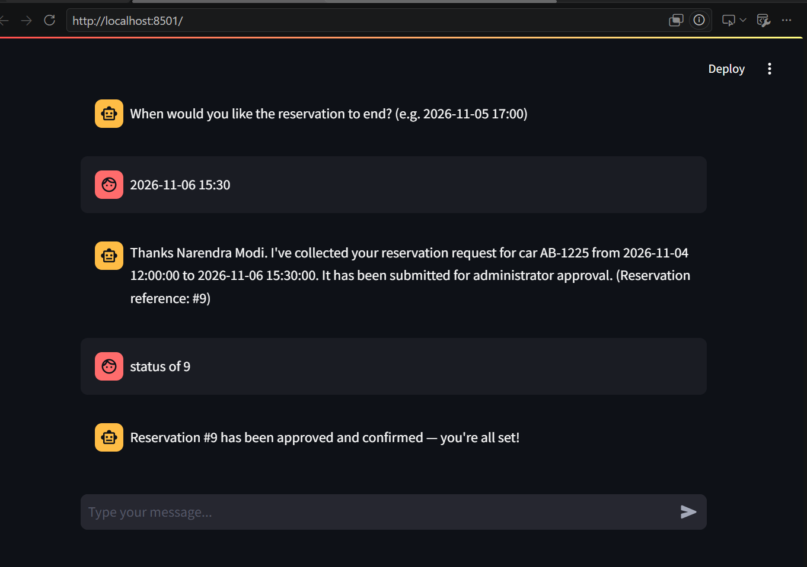
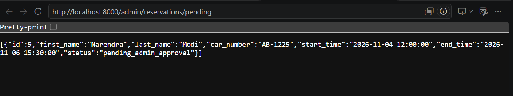
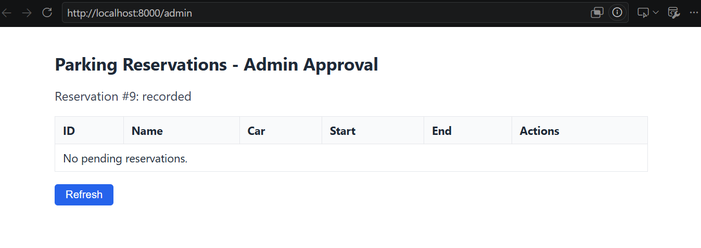
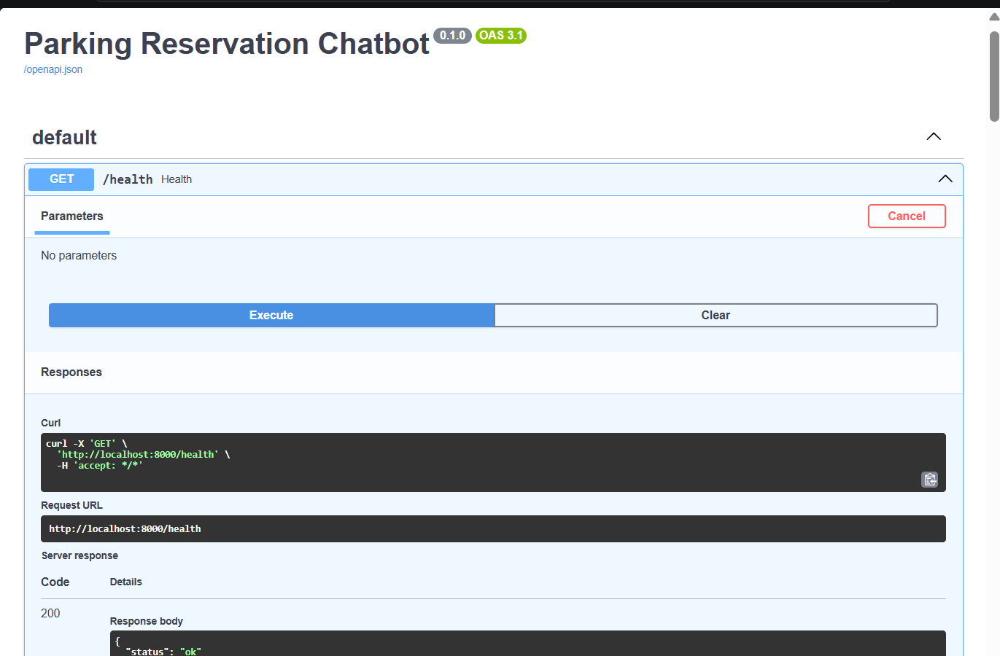
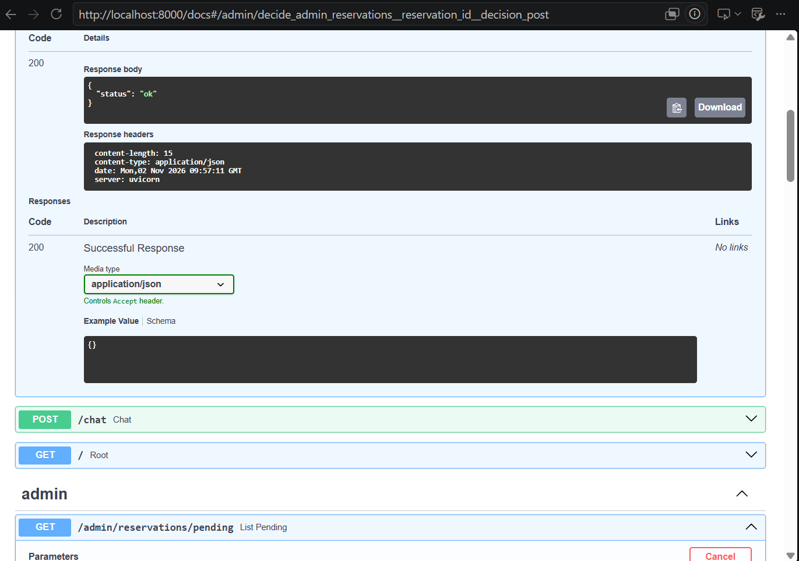
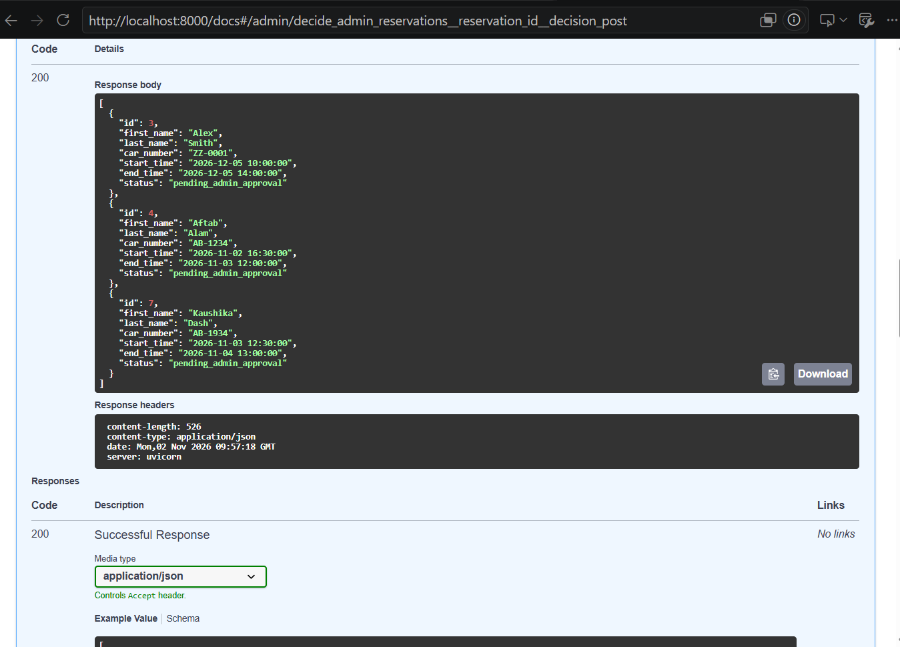
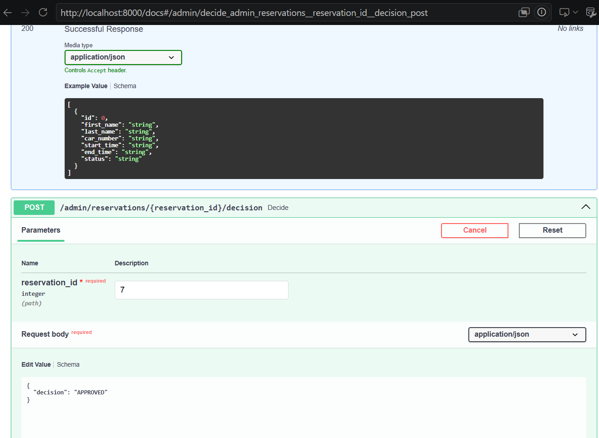

# Parking Reservation Chatbot

An intelligent chatbot for a parking facility, built with **LangChain** + **LangGraph** on a
**Retrieval-Augmented Generation (RAG)** architecture, with a human-in-the-loop administrator
approval step and an MCP server that records confirmed reservations.

All four stages of the project are implemented:

1. **RAG chatbot** — answers questions, collects reservation details interactively.
2. **Human-in-the-loop admin agent** — escalates completed reservations to an administrator and
   waits for their decision.
3. **MCP server** — writes approved reservations to a file.
4. **LangGraph orchestration** — a single graph, paused/resumed with `interrupt()`/`Command`,
   ties stages 2 and 3 together.

**Contents:** [What it does](#what-it-does) · [Architecture](#architecture) ·
[Project structure](#project-structure) · [Setup](#setup) · [Usage](#usage) ·
[Screenshots](#screenshots) · [Guardrails](#guardrails) · [Evaluation](#evaluation) ·
[Load testing](#load-testing-stage-4) · [Admin agent](#human-in-the-loop-admin-agent-stage-2) ·
[MCP server](#mcp-server-stage-3) · [Orchestration](#orchestration-stage-4) · [Tests](#tests) ·
[IaC](#infrastructure-as-code) · [Known limitations](#known-limitations)

## What it does

- Answers general questions about the parking facility (location, booking process, rules, FAQs)
  using RAG over a **Qdrant** vector store.
- Looks up **dynamic data** (space availability, prices, working hours) live from **PostgreSQL**,
  instead of baking it into the static knowledge base.
- Interactively collects reservation details from the user (first name, surname, car number,
  reservation start/end time) through a slot-filling agent.
- Once a reservation is collected, automatically escalates it to a human administrator (email, or
  logged if no SMTP server is configured) and pauses the pipeline until they approve or reject it
  through a REST API.
- On approval, writes the confirmed reservation to a file via a small MCP-style server:
  `Name | Car Number | Reservation Period | Approval Time`.
- Lets the user ask the chatbot itself whether their reservation has been approved
  (`"status of reservation #5"`, `"has it been approved?"`) -- the feedback loop from Stage 2/4
  back into the Stage-1 chat.
- Ships a small clickable admin page (`GET /admin`) to approve/reject pending reservations without
  needing curl/Postman.
- Applies a **guardrail** that blocks PII (emails, phone numbers, card/SSN-like numbers, named
  individuals) from ever being written into the vector store, and redacts any PII that might slip
  into a generated response before it reaches the user.
- Ships an evaluation suite (retrieval accuracy, latency) and a load-testing suite (chatbot,
  admin confirmation, MCP recording under concurrency), plus a full end-to-end integration test
  covering all four stages.

## Architecture

```
                         ┌──────────────────────────┐
  User message  ───────► │   LangGraph StateGraph    │
                         │   (chatbot_graph.py)       │
                         │   classify_intent          │
                         │        │                   │
                         │   ┌────┼────────┐           │
                         │   ▼    ▼        ▼           │
                         │ reserve dynamic  static      │
                         │  agent  info     RAG         │
                         │   │     │         │          │
                         │   └─────┴────┬────┘          │
                         │              ▼                │
                         │        guardrail_filter       │
                         └──────────────┬────────────────┘
                                        ▼
                                  response to user
                                        │
                        reservation complete? ──────────────┐
                                                              ▼
                                      ┌───────────────────────────────────┐
                                      │  Orchestrator graph (Stage 4)       │
                                      │  (orchestrator_graph.py)            │
                                      │                                      │
                                      │  user_interaction                    │
                                      │        │                             │
                                      │        ▼                             │
                                      │  notify_admin  ──► admin (email/REST) │
                                      │        │                             │
                                      │        ▼                             │
                                      │  await_admin_decision  ⏸ interrupt()  │
                                      │        │   (resumed by admin via      │
                                      │        │    POST /admin/.../decision) │
                                      │   ┌────┴────┐                        │
                                      │   ▼         ▼                        │
                                      │ data_      reject_                   │
                                      │ recording  reservation                │
                                      │   │                                   │
                                      │   ▼                                   │
                                      │  MCP server -> confirmed_reservations.txt │
                                      └───────────────────────────────────────┘

  Static knowledge (general info, location, booking   -> Qdrant (vector DB)
  process, FAQs)

  Dynamic data (availability, prices, working hours,   -> PostgreSQL (SQL DB)
  reservations, approval status)
```

See [`docs/architecture.md`](docs/architecture.md) for a detailed breakdown of each node and
module.

## Project structure

```
app/
  config.py                 Settings (env vars)
  main.py                   FastAPI app entrypoint (/chat + /admin routers)
  agents/
    reservation_agent.py    Slot-filling logic for collecting a reservation (Stage 1)
    admin_agent.py           The "second agent": drafts/sends the admin approval
                              request, interprets free-text admin replies (Stage 2)
  api/
    routes.py                /chat, /health endpoints
    schemas.py
    admin_routes.py           GET /admin (clickable approval page), /admin/reservations/pending,
                               /admin/reservations/{id}/decision (Stage 2)
  database/
    models.py                 SQLAlchemy models (dynamic data + reservations)
    session.py, seed.py, dynamic_service.py
  graph/
    chatbot_graph.py          LangGraph: the per-turn RAG chatbot (Stage 1)
    orchestrator_graph.py      LangGraph: admin-approval + data-recording pipeline,
                                paused/resumed with interrupt()/Command (Stage 4)
  rag/
    ingest.py                 Load -> guardrail -> embed -> upsert to Qdrant
    retriever.py               Qdrant-backed retriever
    chain.py                    RAG prompt + LLM chain for static questions
  security/
    guardrails.py               PII detection/redaction (regex + spaCy NER)
  notifications/
    email_client.py             SMTP wrapper, degrades to logging if unconfigured (Stage 2)
  mcp_client/
    client.py                   HTTP client for the MCP server (Stage 3)
mcp_server/
  app.py                        FastAPI "MCP-style" server: tool discovery + tool call (Stage 3)
  storage.py                    Validates and appends confirmed reservations to a file
frontend/
  streamlit_app.py               Minimal chat UI calling the FastAPI backend
data/
  knowledge/                     Static markdown knowledge base
  reservations/                  MCP server output (confirmed_reservations.txt, gitignored)
evaluation/
  evaluate_retrieval.py           Recall@K / Precision@K
  evaluate_latency.py             p50/p95 retrieval + end-to-end latency
  load/                            Load tests (Stage 4): chatbot, admin confirmation, MCP writes
tests/                           pytest suite (mocked external services + full integration test)
docker/                          docker-compose for Qdrant + PostgreSQL + MCP server + app
terraform/                       IaC equivalent of docker-compose (docker provider)
.github/workflows/ci.yml         CI: installs deps and runs pytest on every push/PR
```

## Setup

### 1. Prerequisites

- Python 3.11+
- Docker (for Qdrant + PostgreSQL + the MCP server)
- An OpenAI API key (for embeddings + chat completion)
- (Optional) an SMTP server/account, if you want the admin-approval notification to be an actual
  email instead of a logged message

### 2. Install

```bash
python -m venv .venv
.venv/Scripts/activate        # Windows
# source .venv/bin/activate   # macOS/Linux
pip install -r requirements.txt
```

### 3. Configure

```bash
cp .env.example .env
# edit .env and set OPENAI_API_KEY
# optionally set ADMIN_EMAIL + SMTP_* to receive real approval-request emails;
# leave SMTP_HOST empty to just log the notification instead (fine for local dev/demo)
```

### 4. Start Qdrant + PostgreSQL + the MCP server

```bash
cd docker
docker compose up -d qdrant postgres mcp
```

> Note: PostgreSQL is exposed on **host port 5433** (not 5432) to avoid clashing with any
> PostgreSQL instance already installed natively on your machine. `.env.example` already reflects
> this.

`docker/docker-compose.yml` also defines an `app` service that builds and runs the FastAPI app
itself (`docker compose up -d` with no service names starts everything, including `app`, once
`.env` has a valid `OPENAI_API_KEY`). For local development it's usually more convenient to run
`uvicorn` directly (steps 6-7) and only containerize Qdrant + PostgreSQL + the MCP server.

### 5. Seed dynamic data and ingest static knowledge

```bash
python -m app.database.seed    # populates availability/pricing/hours tables
python -m app.rag.ingest       # embeds data/knowledge/*.md into Qdrant
```

### 6. Run the MCP server (Stage 3)

```bash
uvicorn mcp_server.app:app --port 8001
```

### 7. Run the main API (Stage 1/2/4)

```bash
uvicorn app.main:app --reload
```

### 8. (Optional) Run the chat UI

```bash
streamlit run frontend/streamlit_app.py
```

## Usage

### Chatting and making a reservation

```bash
curl -X POST http://localhost:8000/chat \
  -H "Content-Type: application/json" \
  -d '{"session_id": "demo", "message": "What are your working hours?"}'

curl -X POST http://localhost:8000/chat \
  -H "Content-Type: application/json" \
  -d '{"session_id": "demo", "message": "I would like to book a parking space"}'
# ... keep posting to /chat with the same session_id to answer each follow-up
# prompt (first name, surname, car number, start time, end time)
```

The chatbot keeps per-`session_id` conversation state (used for the multi-turn reservation
slot-filling flow) in memory for the lifetime of the server process. Once all five fields are
collected, the response includes a reservation reference number (`#<id>`) and the admin-approval
pipeline (Stage 2/4) is triggered automatically in the background.

### Checking a reservation's status from the chatbot

```bash
curl -X POST http://localhost:8000/chat -H "Content-Type: application/json" \
  -d '{"session_id":"demo","message":"what is the status of reservation #5?"}'
# -> "Reservation #5 is still awaiting administrator approval."
# ... or, after the admin decides:
# -> "Reservation #5 has been approved and confirmed -- you're all set!"
# -> "Reservation #5 was rejected by the administrator."
```

If you don't give a reference number, it uses the last reservation made in that same chat
session (e.g. just ask `"has it been approved?"` right after booking).

### Administrator approval (Stage 2)

The easiest way: open **http://localhost:8000/admin** in a browser -- a page listing every
pending reservation with **Approve**/**Reject** buttons.

Or via the REST API directly:

```bash
# See what's waiting for a decision
curl http://localhost:8000/admin/reservations/pending

# Approve (writes the reservation to file via the MCP server) or reject it
curl -X POST http://localhost:8000/admin/reservations/<id>/decision \
  -H "Content-Type: application/json" -d '{"decision": "approved"}'

curl -X POST http://localhost:8000/admin/reservations/<id>/decision \
  -H "Content-Type: application/json" -d '{"decision": "rejected"}'
```

An approved reservation ends up appended to `data/reservations/confirmed_reservations.txt` in the
format `Name | Car Number | Reservation Period | Approval Time`.

### Useful links while the servers are running

| What | URL |
|---|---|
| Chat UI (Streamlit) | http://localhost:8501 |
| Admin approval page | http://localhost:8000/admin |
| API docs (Swagger) | http://localhost:8000/docs |
| MCP server health | http://localhost:8001/health |

## Screenshots

All screenshots below are from a real run of this system (see `screenshots/`).

### 1. Making a reservation through the chat UI

The Streamlit chat UI (`frontend/streamlit_app.py`, http://localhost:8501) driving the Stage-1
slot-filling flow: the user asks to book a slot, and the chatbot asks for each required field one
at a time (first name, surname, car number, start time, end time).




### 2. Reservation confirmed, then checked via chat (Stage 2/4 feedback loop)

Once all fields are collected, the bot returns a reservation reference number (`#9`) and submits
it for administrator approval. Asking `"status of 9"` right afterward shows the chatbot can report
back on an administrator's decision -- here it already shows **approved and confirmed**, because
the admin had approved it before this message was sent.



### 3. Admin queue as raw JSON (`GET /admin/reservations/pending`)

The same reservation (`#9`) sitting in the pending queue, returned by the plain REST endpoint --
useful for scripting/automation rather than the browser page.



### 4. The clickable admin approval page (`GET /admin`, Stage 2)

The small HTML/JS admin page listing pending reservations with Approve/Reject buttons. In this
screenshot, reservation `#9` has just been approved (note "Reservation #9: recorded" at the top)
and the table is now empty, confirming the approval went through end-to-end (DB status update +
MCP file write).



### 5. API documentation (Swagger UI, `GET /docs`)

FastAPI's auto-generated interactive API docs -- useful for exploring/testing every endpoint
without writing curl commands.

- Trying out `GET /health`:

  

- Browsing the `admin` section, with `GET /admin/reservations/pending` expanded:

  

- The actual response body of `GET /admin/reservations/pending` -- three reservations waiting on
  an administrator decision:

  

- The `POST /admin/reservations/{reservation_id}/decision` endpoint, ready to submit an approval
  for reservation `#7`:

  

## Guardrails

`app/security/guardrails.py` is used in two places:

1. **Ingestion time** (`app/rag/ingest.py`): every document chunk is scanned before being
   embedded; chunks that look like they contain personal data are rejected and never stored in
   Qdrant.
2. **Response time** (`guardrail_filter` node in `app/graph/chatbot_graph.py`): every response is
   scanned and any PII is redacted before being returned to the user.

Detection combines regex rules (email, phone, credit card, SSN-like numbers) with the pretrained
spaCy `en_core_web_sm` NER model (flagging `PERSON` entities). spaCy is optional — if the model
isn't installed, the guardrail degrades gracefully to regex-only detection. Install it with:

```bash
python -m spacy download en_core_web_sm
```

## Evaluation

```bash
python -m evaluation.evaluate_retrieval   # Recall@K / Precision@K
python -m evaluation.evaluate_latency     # p50/p95 latency, retrieval-only vs end-to-end
```

Results are written up in [`evaluation/REPORT.md`](evaluation/REPORT.md) once generated (requires
a real `OPENAI_API_KEY` and a populated Qdrant collection -- see **Known limitations** below).

## Load testing (Stage 4)

`evaluation/load/` fires concurrent requests at the **running** servers (not mocked -- start
`app.main` and `mcp_server.app` first) and reports latency (p50/p95/max) + throughput, covering
the three components Stage 4 explicitly asks to load-test:

```bash
python -m evaluation.load.load_test_chatbot --total 100 --concurrency 20   # interactive chat
python -m evaluation.load.load_test_admin --total 20 --concurrency 10      # admin confirmation
python -m evaluation.load.load_test_mcp --total 100 --concurrency 20       # MCP file writes
```

`load_test_admin.py` and `load_test_mcp.py` seed their own test reservations/rows (prefixed
`LoadTest`) and scrub them from the DB/output file afterwards by default (pass `--keep-data` to
inspect them). `load_test_mcp.py` also verifies file integrity under concurrency (that the
file-lock prevents interleaved/corrupted writes).

Running these surfaced and fixed two real concurrency bugs:
- A race in the guardrails' lazy spaCy-model loader could let a concurrent request slip through
  with **no PII redaction at all** during the model's ~2s load window. Fixed with proper
  double-checked locking (`app/security/guardrails.py`) and a startup warm-up (`app/main.py`).
- `admin_agent.get_llm()` / `rag/chain.py`'s `get_llm()` built a brand-new `ChatOpenAI` client on
  every call, which made concurrent admin decisions *slower*, not faster. Fixed by caching the
  client (same lock pattern) and adding explicit `timeout`/`max_retries` so a bad API key fails
  fast instead of absorbing the SDK's default retry/backoff.

## Human-in-the-loop admin agent (Stage 2)

`app/agents/admin_agent.py` drafts a short approval-request message (via an LLM call, with a
deterministic template fallback if that fails) and sends it through
`app/notifications/email_client.py`. If `SMTP_HOST` isn't configured, the notification is logged
instead of emailed — the administrator still acts through the REST API either way:
`GET /admin/reservations/pending` and `POST /admin/reservations/{id}/decision`
(`app/api/admin_routes.py`).

## MCP server (Stage 3)

`mcp_server/app.py` is a small FastAPI service exposing a `write_reservation` MCP-style tool
(`GET /mcp/tools`, `POST /mcp/tools/write_reservation/call`), guarded by a shared bearer token
(`MCP_API_KEY`). `mcp_server/storage.py` validates/sanitizes every field (rejects empty/overlong
values, strips `|`/newlines so a value can't inject an extra record) and appends to a fixed file
path under a file lock, so concurrent approvals can't corrupt the output. The main app talks to
it over HTTP via `app/mcp_client/client.py`.

## Orchestration (Stage 4)

`app/graph/orchestrator_graph.py` is a LangGraph `StateGraph` with checkpointing
(`user_interaction -> notify_admin -> await_admin_decision -> data_recording | reject_reservation`).
`await_admin_decision` calls LangGraph's `interrupt()`, so the graph pauses there until the admin
posts a decision; the REST handler resumes it with `Command(resume=...)` on the same `thread_id`.
`app/api/routes.py` kicks this pipeline off automatically once the Stage-1 chatbot graph reports a
completed reservation.

The checkpointer (`MemorySaver`) only lives in process memory, so a server restart loses any
in-flight "waiting for admin" pause. `resume_with_decision` self-heals this: if there's no paused
state for a reservation when a decision comes in, it transparently re-escalates first and then
applies the decision, so an admin's click never silently fails even after a restart.

## Tests

```bash
pytest -q
```

79 tests cover every module (guardrails, RAG chain/retriever/ingest, reservation slot-filling,
dynamic data service, admin agent, email client, MCP server + client, orchestrator graph, admin
API, chatbot graph including the status-check and guardrail thread-safety regressions) plus a
full end-to-end integration test that drives a reservation through all four stages (chat -> admin
notification -> approval -> MCP file write) against an in-memory SQLite DB. All external services
(OpenAI, SMTP, the MCP server's HTTP transport) are mocked, so the suite runs without any API key
or running containers — this is also what CI (`.github/workflows/ci.yml`) runs on every push/PR.
(The load tests in `evaluation/load/` are separate -- they need real running servers and are not
part of this pytest suite or CI.)

## Infrastructure as Code

`terraform/` provisions the same Qdrant + PostgreSQL containers as `docker/docker-compose.yml`,
using the `kreuzwerker/docker` Terraform provider:

```bash
cd terraform
terraform init
terraform apply
```

## Known limitations

- **No real OpenAI key configured by default**: with a placeholder `OPENAI_API_KEY`, general/
  location/FAQ questions (the RAG path) degrade gracefully to a fallback message instead of
  answering, admin-notification drafting falls back to a plain template, and
  `evaluation/evaluate_retrieval.py` / `evaluate_latency.py` / `REPORT.md` can't be run for real.
  Set a real key and run `python -m app.rag.ingest` to light all of this up.
- **No persistent approval checkpoint across restarts**: the orchestrator's `MemorySaver` is
  in-memory only (self-heals on the next decision, see **Orchestration** above, but a pending
  reservation's pause state is lost on restart in the meantime).
- **Vector DB is Qdrant**, not Milvus/Pinecone/Weaviate as the spec's examples list -- functionally
  equivalent for this project's scope, called out here for transparency.
- **No admin UI for anything beyond approve/reject** (e.g. no history view of past decisions) --
  only the live pending queue at `GET /admin`.
- **Single-process, in-memory session state** (`app/api/routes.py`'s `_sessions` dict) -- fine for
  a demo/single instance, would need Redis/Postgres-backed sessions to scale horizontally.
